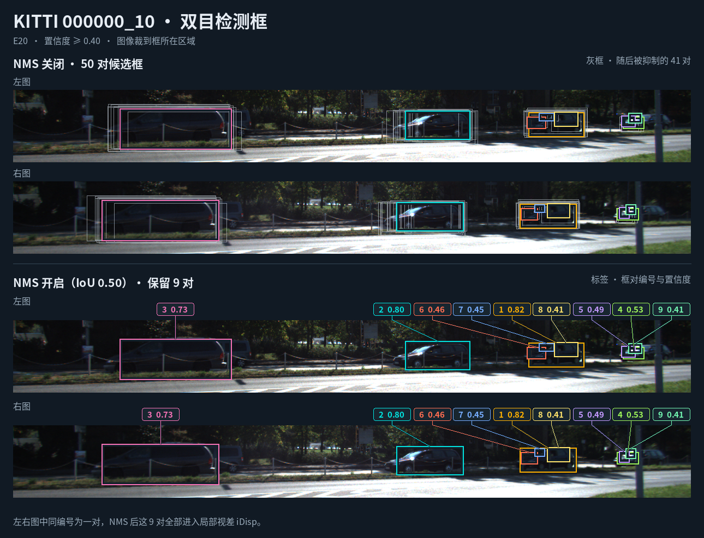

# Jetson Orin NX 单帧配对 NMS 与选框评测

在 Jetson Orin NX 上，用同一对 KITTI Stereo 2015 左右图和 E20 fixed_56 权重比较配对 NMS 开关。开启 IoU 0.50 的配对 NMS 后，进入局部视差的框对从 **50 对降到 9 对**，完整前向 P50 从 **838.9 ms 降到 396.4 ms**，耗时减少 **52.7%**。

## 实验配置

- 代码基线 `d8082d240a4fdc62463085be4fb6099f75264f93`，OpenStereo `23d71c92e33ad1f80dfc42bf29f5c6a914d38769`。
- KITTI Stereo 2015 测试帧 `000000_10`，原图 1242×375。官方数据中的左图为 `testing/image_2/000000_10.png`，右图为 `testing/image_3/000000_10.png`。[KITTI Stereo 2015](https://www.cvlibs.net/datasets/kitti/eval_scene_flow.php?benchmark=stereo)
- 权重 `models/stereo-yolo26-fixed56-seed17-e20.pt`，置信度 0.40，候选上限 500，关闭近车筛选。[权重校验和](../../models/SHA256SUMS)
- Jetson Orin NX，PyTorch 2.8.0，timm 0.4.12，CUDA FP32，batch 1 对双目图。cuDNN 使用确定性模式，关闭 autotune。

## 检测框与视差负载



灰色框表示被抑制的 41 对候选框。彩色框表示保留的 9 对，同编号对应左右框。每个保留下来的框对各生成一个局部代价体。NMS 关闭和开启时的代价体张量分别是 `[50, 33, 56, 56]` 和 `[9, 33, 56, 56]`，回归得到相应数量的 56×56 局部视差图。

配对 NMS 按分数优先，要求同类候选的左右 IoU 都超过 0.50 才抑制低分框。图中 **#6、#7、#8** 在两目中各有至少 93% 的自身面积被 **#1** 覆盖，符合车身局部重复框的表现。以 #7 为例，它在左右图都完全落在 #1 内，但左右 IoU 分别只有 0.089 和 0.059，所以仍进入 iDisp。最右侧的 #4、#5、#9 也互有重叠，单帧可视化不足以确定它们是否对应同一辆车。图中编号按开启 NMS 后的分数顺序排列。[配对 NMS 实现](../../src/lightbackbone_stereo_yolo/detection.py#L102)

在已保存的 9 对框上离线重放双目覆盖规则。按分数从高到低处理，同类低分框在左右图都比同一个已保留的高分框小，且各有至少 90% 的自身面积被覆盖时抑制整对。结果是 **#1 抑制 #6、#7、#8**，候选由 9 对降到 6 对。阈值 0.85 同样保留 6 对，阈值 0.95 保留 7 对。这一实验只重放选框规则，其延迟、车辆召回和视差精度有待在线推理和标注集验证。

## GPU 耗时

两种设置各自预热 5 次，再对单帧重复测量 20 次。完整前向从输入已经在 GPU 开始，到输出完成并同步 GPU 为止。分阶段使用 CUDA events。检测解码与 RoI 调度包含对应设置下的配对 NMS 开销。两种设置分开运行，表内差值反映这两轮单帧实测。

| 阶段或指标 | NMS 关闭 | NMS 开启，IoU 0.50 |
| --- | ---: | ---: |
| 进入 iDisp 的框对数 | 50 | 9 |
| 共享编码器 P50 | 164.4 ms | 195.3 ms |
| 检测头 P50 | 16.5 ms | 21.0 ms |
| 检测解码与 RoI 调度 P50 | 6.9 ms | 16.3 ms |
| RoI 采样 P50 | 23.5 ms | 19.1 ms |
| iDisp P50 | 610.5 ms | 152.8 ms |
| Mask P50 | 20.5 ms | 4.5 ms |
| 完整前向 P50 | **838.9 ms** | **396.4 ms** |
| 完整前向 P95 | 1122.0 ms | 496.0 ms |

## MobileNetV3 编码器速度对照

用同一双目输入，交替测量 24 轮。编码器时间包含 FPN 和特征适配层，所有版本对外输出相同形状的 P2、P3、P4、C5。V3 原型使用随机权重，测量范围为编码器；完整前向以 396.4 ms 为基线，按同轮编码器延迟差的中位数推算，假设后续阶段的耗时和 9 对框的负载相同。更换骨干网络后的检测和视差精度需要训练后验证。

| 编码器 | 实测 P50 | 完整前向 P50 |
| --- | ---: | ---: |
| MobileNetV2 | 212.7 ms | 396.4 ms（此前 NMS 开启实测） |
| MobileNetV3-Large | 179.5 ms | 约 359 ms（推算） |
| MobileNetV3-Small | 81.2 ms | 约 264 ms（推算） |

## 复现推理输出

按[仓库说明](../../README.md#inference)准备依赖和上述 OpenStereo 版本，从仓库根目录运行。去掉 `--paired-nms --paired-nms-iou .50` 即可生成 NMS 关闭的输出，使用不同的 `--output` 路径保存。

```bash
python scripts/infer.py \
  --openstereo-source /path/to/OpenStereo \
  --left /path/to/testing/image_2/000000_10.png \
  --right /path/to/testing/image_3/000000_10.png \
  --device cuda:0 --score .40 --paired-nms --paired-nms-iou .50 \
  --output outputs/000000_10-nms050.npz
```

- NMS 关闭：[推理 NPZ](kitti2015_000000_10_cuda.npz) · [20 次计时](kitti2015_000000_10_timing.json)
- NMS 开启：[推理 NPZ](kitti2015_000000_10_cuda_nms050.npz) · [20 次计时](kitti2015_000000_10_nms050_timing.json)
- 编码器对照：[24 轮计时](kitti2015_000000_10_mobilenet_encoder_timing.json)
